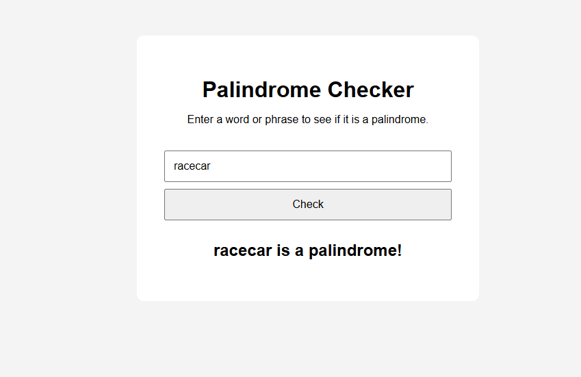

# Palindrome Checker

A web application that checks whether a word or phrase is a palindrome using server-side JavaScript.

Built with HTML, CSS, JavaScript, and Node.js, the application uses a custom HTTP server and API endpoint to process user input, compare reversed strings, and return the result to the frontend.

## Live Demo

**[Try the Palindrome Checker](https://palindrome-klx7.onrender.com/)**

## Technologies


## Features

- Check whether a word or phrase is a palindrome
- Process and validate strings on a Node.js backend
- Ignore capitalization and whitespace when comparing strings
- Reverse strings and compare them with the original input
- Display whether the input is a palindrome
- Communicate with the backend using the Fetch API
- Update results dynamically without reloading the page
- Custom Node.js HTTP server without Express
- Deployed on Render

## Screenshot



## How It Works

1. Enter a word or phrase in the input field.
2. Click **Check**.
3. The frontend sends the input to the Node.js server.
4. The server converts the input to lowercase and removes whitespace.
5. The server reverses the cleaned string.
6. If both strings match, the input is identified as a palindrome.
7. The API returns the result as JSON, and JavaScript displays the message.

For example:

- `racecar` is a palindrome.
- `Never odd or even` is a palindrome.
- `hello` is not a palindrome.

**Note:** The current implementation ignores capitalization and whitespace but does not remove punctuation.

## API Endpoint

### GET /api

Checks whether a supplied string is a palindrome.

**Example request:**

```http
GET /api?input=racecar
```

**Example response:**

```json
{
  "input": "racecar",
  "palindrome": true,
  "message": "racecar is a palindrome!"
}
```

## Getting Started

### 1. Clone the Repository

```bash
git clone https://github.com/AnwarAlshohatee/palindrome.git
cd palindrome
```

### 2. Install Dependencies

Requires Node.js and npm.

```bash
npm install
```

### 3. Start the Server

```bash
npm start
```

Open the application at:

```text
http://localhost:8000
```

## Project Structure

```text
palindrome/
├── css/
│   └── style.css
├── js/
│   └── main.js
├── index.html
├── server.js
├── package.json
├── palindrome.PNG
└── README.md
```

## Future Improvements

- Ignore punctuation and special characters when checking phrases
- Add input validation and error handling
- Support checking palindromes by pressing Enter
- Display loading and error messages
- Add automated tests for the palindrome-checking logic
- Improve accessibility and mobile responsiveness

## Author

**Anwar Alshohatee**

[Portfolio](https://anwaralshohatee.netlify.app) | [LinkedIn](https://www.linkedin.com/in/anwaralshohatee/)
